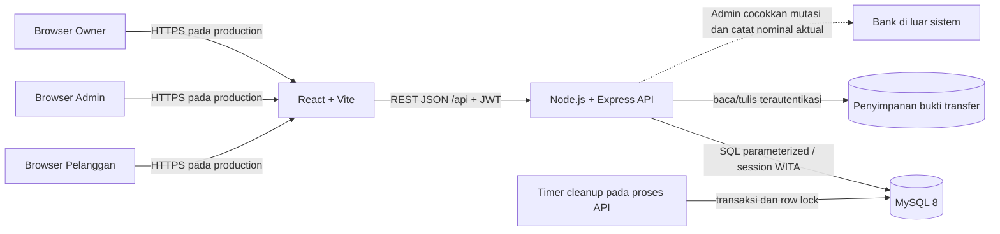

# Arsitektur Sistem BookPoint

**Baseline:** SRS BookPoint v2.0  
**Status:** Dokumentasi desain untuk implementasi repository ini. Dokumen ini
tidak menyatakan bahwa aplikasi telah di-deploy atau bahwa HTTPS produksi telah
diverifikasi.

## Diagram komponen dan aliran data

## Komponen dan tanggung jawab

| Komponen | Tanggung jawab | Catatan implementasi |
|---|---|---|
| React + Vite | Login/registrasi, jadwal, booking, pembayaran manual, member, laporan, dan master data. | Panggilan API memakai `VITE_API_URL`; instruksi pembayaran publik opsional memakai `VITE_PAYMENT_INSTRUCTIONS`. |
| Express REST API | Validasi aturan bisnis, JWT, otorisasi per role, transaksi booking/pembayaran, laporan, dan audit. | Prefix endpoint `/api`; role dicek pada middleware dan endpoint. |
| MySQL 8 | Data pelanggan/akun, jadwal, reservasi slot, booking, pembayaran, member, refund manual, dan riwayat. | Zona waktu sesi dikunci ke WITA (`+08:00`) agar `NOW()` dan `CURDATE()` konsisten dengan GOR. |
| Penyimpanan bukti | Menyimpan gambar bukti DP yang diunggah. | Akses melalui endpoint API terautentikasi; volume persisten dibutuhkan pada hosting filesystem ephemeral. |
| Cleanup booking | Membatalkan booking `menunggu_dp` saat batas dua jam lewat, melepaskan slot, dan menulis riwayat aktor Sistem. | Timer berjalan di proses API. Produksi harus memastikan setidaknya satu proses aktif dan database tetap menjadi sumber kebenaran. |

## Autentikasi, otorisasi, dan batas kepercayaan

1. Pelanggan masuk dengan nomor HP; Admin dan Owner masuk dengan username.
   Registrasi publik hanya membuat akun pelanggan.
2. Password disimpan sebagai bcrypt hash. API memberikan JWT berumur terbatas;
   middleware memeriksa akun masih aktif pada database untuk setiap request.
3. Pelanggan hanya dapat membaca/mengubah booking miliknya. Admin menangani
   operasi booking, verifikasi DP, pelunasan tunai, member, refund manual, dan
   pembatalan oleh GOR. Owner mengakses laporan, data master, serta riwayat
   booking baca-saja.
4. Bukti transfer tidak disajikan sebagai direktori statis. Admin memeriksa
   mutasi bank di luar sistem; tidak ada payment gateway atau notifikasi
   WhatsApp otomatis.
5. HTTPS harus disediakan oleh hosting/reverse proxy pada production. CORS
   membatasi origin frontend melalui `CLIENT_ORIGIN`; konfigurasi lokal hanya
   untuk development.

## Alur transaksi inti

### Booking dan penguncian slot

API memvalidasi setiap slot, harga, tanggal, jam operasional, dan batas booking
berdasarkan status member. Pembuatan booking, detail, reservasi, pembayaran DP
(jika tunai), dan riwayat berada dalam satu transaksi. Primary key
`reservasi_slot(id_lapangan, tanggal, jam_mulai)` menjadi pengunci atomik:
request bersamaan untuk slot yang sama hanya dapat berhasil satu kali.

### DP dan pembatalan otomatis

Booking transfer dibuat `menunggu_dp` dengan tenggat dua jam. Satu DP aktif
dibatasi oleh generated unique key pada database. Bukti ditinjau Admin sebelum
tenggat; setelah ditolak pelanggan dapat mengganti bukti pada baris yang sama.
Timer API menutup booking yang melewati tenggat dan melepas semua slot dalam
transaksi.

### Pembatalan dan reschedule

Pembatalan pelanggan mencatat alasan serta aturan DP hangus bila kurang dari
24 jam sebelum slot pertama. Reschedule hanya satu kali dan harus dilakukan
lebih dari 24 jam sebelum slot pertama; slot lama dan baru diproses atomik.
Pembatalan oleh GOR wajib memiliki alasan, melepas slot, dan tidak otomatis
menghanguskan DP. Refund dicatat Admin setelah transfer/tunai dilakukan di luar
sistem.

## Deployment dan operasi

- Local development: Vite pada port 5173 dan API pada port 5000.
- Production dapat memakai frontend dan API terpisah; set `VITE_API_URL`,
  `CLIENT_ORIGIN`, kredensial MySQL, dan `JWT_SECRET` melalui secret/environment
  manager hosting. Jangan menyimpan secret pada frontend atau repositori.
- Gunakan HTTPS untuk kedua origin. Verifikasi `/api/health`, CORS, koneksi
  database, volume upload persisten, backup/restore, dan scheduler sebelum rilis.
- Timer saat ini melekat pada proses API, bukan layanan scheduler terpisah.
  Jangan menyatakan SLA, high availability, backup otomatis, atau load test
  terpenuhi tanpa konfigurasi dan bukti operasional.

## Keterlacakan

- Alur jadwal/booking/pembayaran: REQ-02 sampai REQ-15 dan aturan BR-01 sampai
  BR-07 serta BR-10 sampai BR-11.
- Membership dan batas booking: REQ-16, BR-08 sampai BR-09.
- Laporan dan data master: REQ-17, REQ-18, REQ-20.
- Nota dan riwayat: REQ-19, REQ-21.
- Pemetaan aktor ke layar/use case: [`../ui/Use_Case_to_Screen_Mapping.md`](../ui/Use_Case_to_Screen_Mapping.md).
